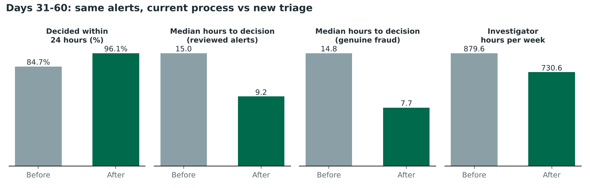
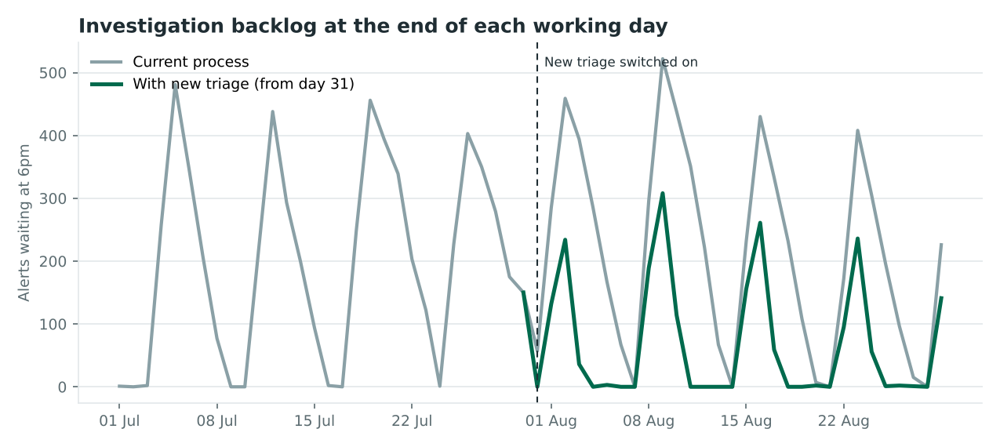
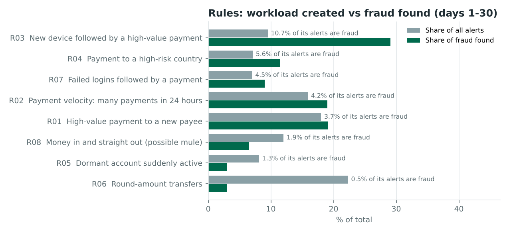
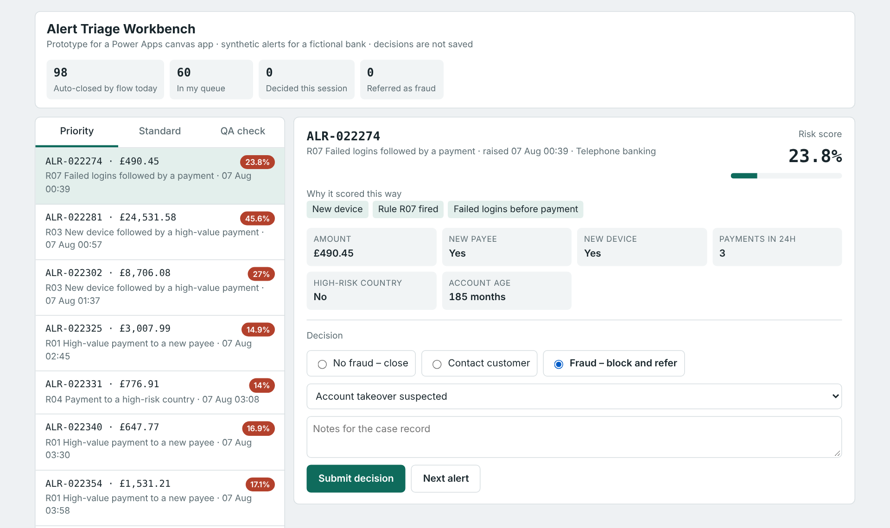
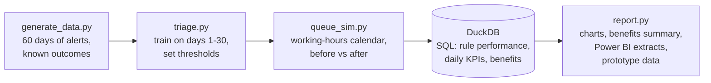

# Fraud Alert Triage Optimisation

**A fraud operations team is drowning in alerts that are almost all false alarms. This project measures today's process, designs a risk-based triage with automation, and proves the benefit on the same alerts before anything goes live, with the Power Platform design to run it.**


> **Data note:** all data is synthetic, for a fictional UK retail bank. No real bank, customer or transaction data is
> used, and the process is a generic illustration of fraud alert operations, not any specific bank's.

---

## The problem

A consumer fraud team of **24 investigators** works alerts raised by **8 transaction-monitoring rules**: about
**600 alerts a day**, of which only **3.7% are genuine fraud**. Every alert is worked first in, first out, so a
high-risk alert raised on Friday evening waits behind hundreds of low-risk ones. The team has little spare capacity, and
**only 84.7% of alerts get a decision within the 24-hour SLA**.

The question for the optimisation team: **can we cut the manual workload and get to genuine fraud faster, without
losing control?**

## What changes

1. **Score every alert** with a risk model trained on past outcomes (11 alert features plus the rule that fired).
2. **Triage into three bands**, with thresholds set on days 1-30 and then left unchanged:
   - **Auto-close** (lowest scores): closed by an automated flow with a logged reason. **5% are still checked by a person** as quality control.
   - **Priority** (top 5% of scores): worked first.
   - **Standard:** everything else, first in, first out.
3. **Measure it properly:** days 31-60 are run twice through a queue simulation with the real working-hours calendar
   (weekdays 08:00-18:00, weekends 40% staffing): once with today's process, once with the new triage.

## Benefits tracking (days 31-60, same alerts)

| Measure | Before | After |
|---|---:|---:|
| Alerts needing an investigator | 17,764 | **14,658** (−17.5%) |
| Investigator hours per week | 879.6 | **730.6** (149 hours, about **4.6 FTE**, released) |
| Alerts decided within 24 hours | 84.7% | **96.1%** |
| Median hours to a decision on genuine fraud | 14.8 | **7.7** |
| Genuine fraud reviewed by a person | 684 | 671 (**98.1%**) |





**The trade-off, stated plainly:** 14 genuine fraud cases (2.0%) scored low enough to be auto-closed and the QA sample
caught 1, so **13 would be missed**. A risk owner would need to accept that, or set a lower auto-close threshold or a
higher QA rate. Both are single settings in `src/config.py`, and the pipeline re-measures the benefit for any setting.
Full write-up: **[docs/benefits_summary.md](docs/benefits_summary.md)**

## Rule tuning opportunity



**R06 Round-amount transfers** creates **22%** of all alerts but finds only **3%** of the fraud: 0.5% of its alerts
are genuine, and each case found costs **41 investigator hours**. It is the obvious first candidate to re-tune with the
rule owner, alongside the triage change.

## How it would run in Power Platform

| Component | Role | Design |
|---|---|---|
| **Dataverse** | One source of truth for alerts, decisions and QA checks, with role-based security and audit | [docs/power_platform/dataverse_schema.md](docs/power_platform/dataverse_schema.md) |
| **Power Automate** | Score and route each new alert; SLA watch with Teams alerts; daily summary and QA follow-up | [docs/power_platform/power_automate_flows.md](docs/power_platform/power_automate_flows.md) |
| **Power Apps** | Investigator workbench: queues by band, risk score with plain-English reasons, decision form | Clickable prototype in [`prototype/workbench.html`](prototype/workbench.html) |
| **Power BI** | Volumes, SLA, backlog and benefits tracking from the same tables | Star-schema CSVs and DAX in [`outputs/powerbi/`](outputs/powerbi/) |



The prototype is an MVP to test the design with investigators before building the canvas app: the queues, what
information sits on screen, and how quick a decision is to record.

## How it works



**Tests** (`pytest`) check that the thresholds use the training period only, the auto-close band respects the fraud
limit, the priority band is 5%, every alert gets a decision after it is raised, the baseline queue is first in,
first out, days 1-30 are identical in both scenarios, and the benefits go in the right direction while keeping at
least 97% of fraud in front of a person.

## Run it yourself

```bash
make setup   # or: pip install -r requirements.txt
make run     # about 20 seconds
make test
```

Open `prototype/workbench.html` in a browser to try the workbench.

## Limitations

- Synthetic data: real alert features, fraud patterns and handling times will differ, and the model would need
  proper validation, monitoring and model-risk sign-off before use.
- The queue simulation assumes steady staffing and no overtime; real rosters, absence and surges would change the numbers.
- Investigators are assumed to find every fraud they review; in practice the QA process would also measure that.

## Tools

**Python** (pandas, scikit-learn, matplotlib) · **SQL** (DuckDB) · **pytest** · **GitHub Actions** ·
design for **Power Apps, Power Automate, Dataverse and Power BI** (DAX)

---

*Saim Hussain · Data & BI Analyst · [LinkedIn](https://www.linkedin.com/in/saim-hussain-data) · [Portfolio](https://claude.ai/artifact/KDNPt6QhGEEjte2aJ4uRjK)*
