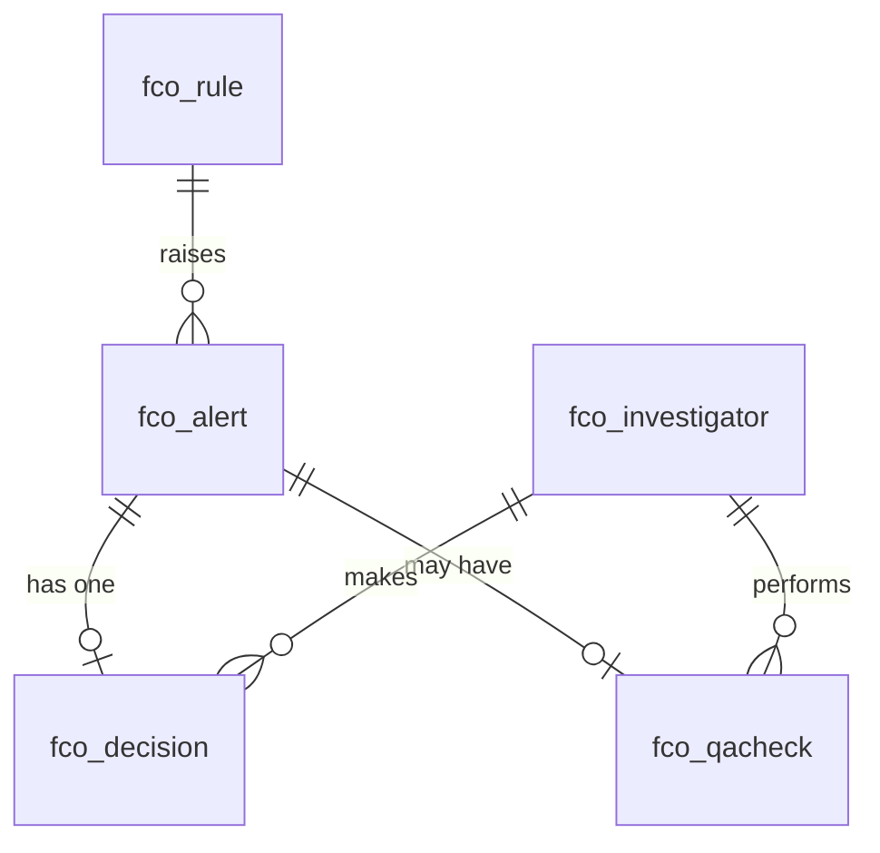

# Dataverse data model

The production version of the workbench stores everything in Dataverse, so the Power App, the Power Automate
flows and the Power BI report all read the same tables. Names use a `fco_` publisher prefix (Fraud Customer Operations).

## fco_alert (one row per alert)

| Column | Type | Notes |
|---|---|---|
| fco_alertid | Primary key (GUID) | |
| fco_alertref | Text, alternate key | e.g. ALR-022274, from the monitoring system |
| fco_rule | Lookup → fco_rule | Rule that raised the alert |
| fco_raisedon | Date and time | |
| fco_customerref | Text | Customer reference only; no personal details held in this table |
| fco_amount | Currency (GBP) | |
| fco_channel | Choice | Mobile app, Online banking, Telephone banking, Branch |
| fco_riskscore | Decimal (0-1) | Written by the scoring flow |
| fco_topreasons | Text (multiline) | Plain-English reasons shown to investigators |
| fco_triageband | Choice | Auto-close, Standard, Priority |
| fco_status | Choice | New, In queue, In review, Decided, Auto-closed |
| fco_qasampled | Yes/No | Auto-close alert selected for a quality check |
| fco_sladuedate | Date and time | Raised on + 24 hours (calculated column) |
| fco_assignedto | Lookup → fco_investigator | Set when an investigator opens the alert |

## fco_decision (one row per decided alert)

| Column | Type | Notes |
|---|---|---|
| fco_alert | Lookup → fco_alert | |
| fco_outcome | Choice | No fraud, Contact customer, Fraud - block and refer |
| fco_reason | Choice | Genuine payment confirmed, Known payee, Customer confirmed, Account takeover, APP scam, Money mule |
| fco_notes | Text (multiline) | |
| fco_decidedby | Lookup → fco_investigator | Blank when the flow auto-closed the alert |
| fco_decidedon | Date and time | |
| fco_handlingminutes | Whole number | Time from opening to submitting, captured by the app |

## fco_qacheck (5% of auto-closed alerts)

| Column | Type | Notes |
|---|---|---|
| fco_alert | Lookup → fco_alert | |
| fco_result | Choice | Agree with auto-close, Overturn - review needed |
| fco_checkedby | Lookup → fco_investigator | |

## fco_rule and fco_investigator

Reference tables: rule ID, name, owner and active flag; investigator name, team and skills.

## Security

- **Investigator** role: read alerts in their team, create decisions, cannot edit the risk score or triage band.
- **Team leader** role: reassign alerts, see all decisions and QA results.
- **Rule owner** role: read-only on alerts and decisions; owns `fco_rule`.
- Audit history switched on for `fco_alert` and `fco_decision`, so every change is traceable.
