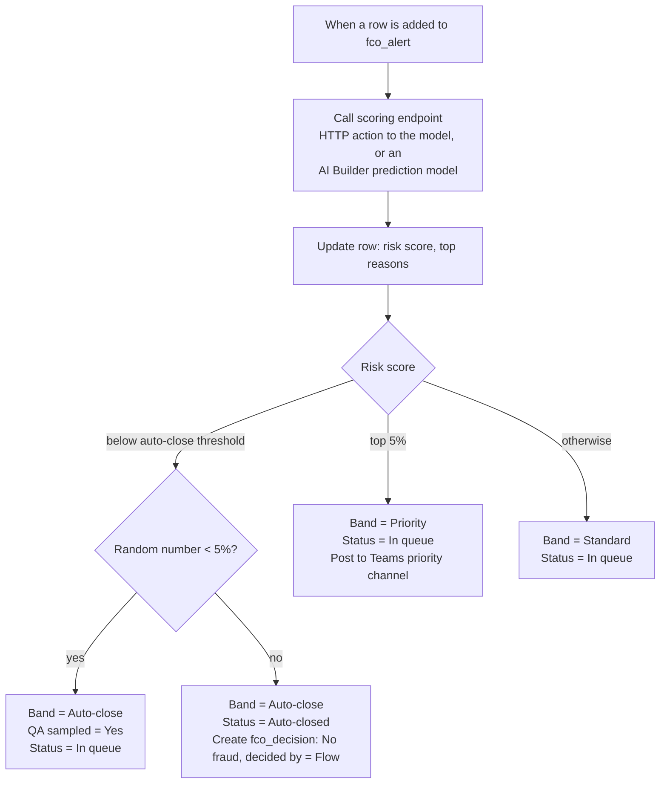

# Power Automate flows

Three cloud flows run the process. In this repository the same logic is implemented in Python (`src/triage.py`,
`src/queue_sim.py`) so it can be tested and measured; the flows below are how it would run in Power Platform.

## Flow 1: Score and route a new alert (automated, on create of `fco_alert`)

- Thresholds are stored in an environment variable, so the rule owner can change them without editing the flow.
- Every auto-close writes a decision row with reason "Auto-closed by triage policy" so the audit trail is complete.

## Flow 2: SLA watch (scheduled, every 30 minutes, 08:00-18:00)

1. List `fco_alert` rows where Status = In queue and SLA due date is within 4 hours.
2. For each, post an adaptive card to the team leader in Teams with the alert, its band and time left.
3. If an alert passes its SLA due date, set a "Breached" flag and include it in the daily summary.

## Flow 3: Daily summary and QA (scheduled, 08:00)

1. Count yesterday's alerts by band, decisions by outcome, QA checks that overturned an auto-close, and SLA breaches.
2. Post the summary to the team channel and refresh the Power BI dataset.
3. If any QA check overturned an auto-close, email the rule owner with the alert details, because the threshold may need moving.

## Why these choices

| Need | Choice |
|---|---|
| Investigators should not wait for scoring | Flow runs on create, before the alert reaches a queue |
| Risk owner controls the trade-off | Thresholds and QA rate in environment variables, not hard-coded |
| Every closure is explainable | Auto-close writes a decision row with a reason |
| Problems with the model are noticed quickly | QA overturns go straight to the rule owner |
